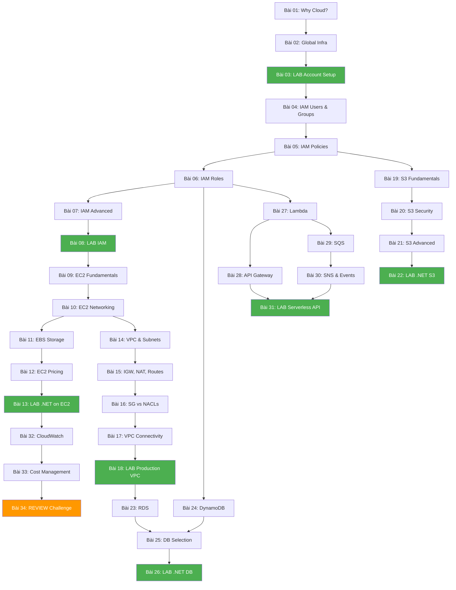

# Phase 1 — Core Foundation: Lesson Map

> **34 bài · 8 tuần · ~70 giờ**
> Nền móng thực tế — 80% giá trị sử dụng hàng ngày

---

## Dependency Graph



> Các node **xanh lá** = LAB thực hành · Node **cam** = Review Challenge

---

## Module 1: AWS Mental Model & Account Setup

> Mục tiêu module: Hiểu "tại sao" trước khi học "cái gì". Setup account an toàn.

---

### 📘 Bài 01: Tại sao Cloud? Tại sao AWS?

| Key | Value |
|-----|-------|
| **Thời gian** | ~60 phút |
| **Loại** | Theory |
| **Prerequisites** | Không có |
| **Sau bài này** | Giải thích được 5 lợi ích cloud vs on-premise; Biết khi nào KHÔNG nên dùng cloud |

**Nội dung chính**:
- Bài toán của on-premise: capacity planning, upfront cost, scaling pain
- 5 đặc tính của Cloud Computing (NIST definition)
- IaaS / PaaS / SaaS — bạn quản lý gì ở mỗi layer
- AWS vs Azure vs GCP — market share, strengths, ecosystem
- **.NET Bridge**: So sánh deploy app .NET lên IIS on-prem vs EC2 vs App Service vs Lambda

**Kết nối**: Bài này → Bài 02 (AWS cụ thể có gì trong "cloud" đó)

---

### 📘 Bài 02: AWS Global Infrastructure — Regions, AZs & Edge Locations

| Key | Value |
|-----|-------|
| **Thời gian** | ~60 phút |
| **Loại** | Theory |
| **Prerequisites** | Bài 01 |
| **Sau bài này** | Chọn được Region phù hợp cho project; Giải thích tại sao Multi-AZ tăng availability |

**Nội dung chính**:
- Region: cluster of data centers, chọn dựa trên latency / compliance / cost / services
- Availability Zone (AZ): 1+ data centers, isolated failure domains
- Edge Locations & Points of Presence (CloudFront, Route 53)
- Local Zones & Wavelength Zones (concept)
- Region selection cho developer Việt Nam: `ap-southeast-1` (Singapore) vs `ap-northeast-1` (Tokyo)
- **.NET Bridge**: Connection string thay đổi theo Region → `RegionEndpoint.APSoutheast1`

**Kết nối**: Bài 02 → Bài 03 (setup account thực tế, chọn region đầu tiên)

---

### 📘 Bài 03: [LAB] AWS Account Setup & Billing Protection

| Key | Value |
|-----|-------|
| **Thời gian** | ~45 phút |
| **Loại** | Hands-on LAB |
| **Prerequisites** | Bài 01, 02 |
| **Sau bài này** | Có AWS account an toàn, MFA enabled, billing alert active |

**Thực hành step-by-step**:
1. Tạo AWS account (nếu chưa có) hoặc verify existing account
2. Enable MFA cho root user (dùng app authenticator)
3. Tạo IAM admin user (KHÔNG dùng root cho daily work)
4. Set default region = `ap-southeast-1`
5. Tạo Billing Alarm: $10, $50, $100 thresholds
6. Enable Cost Explorer
7. Cài AWS CLI v2, configure với IAM user credentials
8. Test: `aws sts get-caller-identity`

**Chi phí**: $0 (tất cả free)

**Kết nối**: Bài 03 → Bài 04 (bắt đầu dive deep vào IAM — thứ bạn vừa dùng để setup)

---

## Module 2: IAM — Identity & Security Core

> Mục tiêu module: Master IAM = master security trên AWS. Đây là service bạn dùng HÀNG NGÀY.

---

### 📘 Bài 04: IAM Users, Groups & Authentication

| Key | Value |
|-----|-------|
| **Thời gian** | ~90 phút |
| **Loại** | Theory + Demo |
| **Prerequisites** | Bài 03 |
| **Sau bài này** | Tạo được user/group structure hợp lý; Hiểu authentication flow |

**Nội dung chính**:
- Root User: tại sao KHÔNG BAO GIỜ dùng cho daily work
- IAM Users: person hoặc application, có credentials riêng
- IAM Groups: tập hợp users, attach policies cho group thay vì user
- Authentication methods: Console password vs Access Keys vs Temporary credentials
- MFA types: Virtual MFA, Hardware token, U2F key
- Password Policy: complexity, rotation, reuse prevention
- **.NET Bridge**: IAM User ≈ `IdentityUser` trong ASP.NET Identity; Group ≈ Role

**Kết nối**: Bài 04 → Bài 05 (users đã có, giờ cần policies để quyết định họ được làm gì)

---

### 📘 Bài 05: IAM Policies — Đọc và Viết JSON Policy Documents

| Key | Value |
|-----|-------|
| **Thời gian** | ~120 phút |
| **Loại** | Theory + Practice |
| **Prerequisites** | Bài 04 |
| **Sau bài này** | Đọc hiểu bất kỳ IAM policy JSON nào; Viết được custom policy từ yêu cầu |

**Nội dung chính**:
- Policy JSON structure: Version, Statement, Effect, Action, Resource, Condition
- AWS Managed Policies vs Customer Managed vs Inline Policies
- Policy evaluation logic: Deny wins, explicit deny > explicit allow > implicit deny
- Wildcard patterns: `s3:Get*`, `arn:aws:s3:::my-bucket/*`
- Policy Simulator tool
- Common policies: S3ReadOnly, EC2FullAccess, custom combinations
- **.NET Bridge**: IAM Policy ≈ `[Authorize(Policy = "CanEditPosts")]` — declarative authorization
- **Thực hành**: Đọc 5 policy mẫu → Viết 3 custom policy từ requirements bằng tiếng Việt

**Kết nối**: Bài 05 → Bài 06 (policies giờ gắn vào Roles — cách services nói chuyện với nhau)

---

### 📘 Bài 06: IAM Roles — Cross-Service Access & Trust Relationships

| Key | Value |
|-----|-------|
| **Thời gian** | ~90 phút |
| **Loại** | Theory + Practice |
| **Prerequisites** | Bài 05 |
| **Sau bài này** | Tạo được IAM Role cho EC2/Lambda; Giải thích được STS AssumeRole flow |

**Nội dung chính**:
- Role vs User: Role = "mũ" có thể đội lên, không có permanent credentials
- Trust Policy (who can assume) vs Permission Policy (what can do)
- Instance Profile: cách EC2 "đội" Role
- Lambda Execution Role: cách Lambda access các service khác
- STS AssumeRole: temporary credentials flow
- Cross-account access với Roles
- **.NET Bridge**: Role ≈ Service Account chạy Windows Service; STS ≈ JWT token exchange
- **Thực hành**: Tạo Role cho EC2 truy cập S3, test `aws s3 ls` từ EC2 (không cần access key)

**Kết nối**: Bài 06 → Bài 07 (advanced patterns: conditions, boundaries, organizations)

---

### 📘 Bài 07: IAM Advanced — Conditions, Boundaries & Organizations

| Key | Value |
|-----|-------|
| **Thời gian** | ~90 phút |
| **Loại** | Theory |
| **Prerequisites** | Bài 06 |
| **Sau bài này** | Hiểu Permission Boundaries; Biết khi nào dùng Organizations & SCPs |

**Nội dung chính**:
- Policy Conditions: `aws:SourceIp`, `aws:RequestedRegion`, `s3:prefix`, `aws:MultiFactorAuthPresent`
- Permission Boundaries: "trần" giới hạn max permissions của user/role
- AWS Organizations: multi-account strategy
- Service Control Policies (SCPs): guardrails cho organization
- Resource-based vs Identity-based policies — interaction rules
- **.NET Bridge**: Permission Boundary ≈ `IAuthorizationRequirement` trần; SCP ≈ global middleware filter

**Kết nối**: Bài 07 → Bài 08 (LAB tổng hợp toàn bộ IAM kiến thức)

---

### 📘 Bài 08: [LAB] IAM Hands-on — Xây Dựng Security Foundation

| Key | Value |
|-----|-------|
| **Thời gian** | ~120 phút |
| **Loại** | Hands-on LAB |
| **Prerequisites** | Bài 04-07 |
| **Sau bài này** | Setup được IAM structure production-ready; Confident với IAM cho real projects |

**Thực hành step-by-step**:
1. Tạo IAM Groups: `Developers`, `Ops`, `ReadOnly`
2. Tạo IAM Users và gán vào Groups
3. Viết custom policy: "S3 read-only cho bucket `my-app-assets`"
4. Viết custom policy: "EC2 start/stop chỉ trong `ap-southeast-1`"
5. Tạo IAM Role cho EC2 → S3 access (không dùng access keys)
6. Tạo IAM Role cho Lambda → DynamoDB + CloudWatch
7. Test tất cả bằng AWS CLI: switch roles, verify permissions
8. Dùng IAM Policy Simulator verify kết quả

**Chi phí**: $0

**Kết nối**: Bài 08 → Bài 09 (giờ bạn có security foundation, bắt đầu tạo EC2 instances)

---

## Module 3: EC2 — Compute Core

> Mục tiêu module: Hiểu compute engine chính của AWS. Deploy được .NET app thực tế.

---

### 📘 Bài 09: EC2 Fundamentals — Instance Types, AMIs & Launch

| Key | Value |
|-----|-------|
| **Thời gian** | ~90 phút |
| **Loại** | Theory + Demo |
| **Prerequisites** | Bài 08 (IAM Role cho EC2) |
| **Sau bài này** | Chọn đúng instance type cho workload; Launch EC2 instance |

**Nội dung chính**:
- EC2 = virtual server, full control OS level
- Instance Type naming: `m5.xlarge` → [family][generation].[size]
- Family guide cho .NET dev:
  - `t3` → dev/test, burstable (free tier)
  - `m5/m6i` → general purpose, production API
  - `c5/c6i` → compute-intensive, image processing
  - `r5/r6i` → memory-intensive, in-memory caching
- AMI: Amazon Machine Image = "snapshot" of OS + software
  - Amazon Linux 2023, Ubuntu, Windows Server
  - Custom AMI: save config đã cài .NET runtime
- Launch process: AMI → Instance Type → Network → Storage → Security Group → Key Pair
- User Data: bootstrap script chạy lần đầu launch
- **.NET Bridge**: EC2 ≈ VPS bạn đã từng deploy, nhưng API-driven và scalable

**Kết nối**: Bài 09 → Bài 10 (instance đã launch, giờ hiểu networking xung quanh nó)

---

### 📘 Bài 10: EC2 Networking — Security Groups, IPs & SSH

| Key | Value |
|-----|-------|
| **Thời gian** | ~90 phút |
| **Loại** | Theory + Practice |
| **Prerequisites** | Bài 09 |
| **Sau bài này** | Configure Security Groups đúng cách; SSH vào EC2; Hiểu IP types |

**Nội dung chính**:
- Security Groups: stateful firewall, rules = allow only (no deny rules)
  - Inbound: ai được vào
  - Outbound: instance được gọi ra đâu (default: all allowed)
  - Reference SG khác thay vì IP (best practice)
- Public IP: changes khi stop/start
- Elastic IP: static public IP (TỐN TIỀN nếu không attach)
- Private IP: stable, trong VPC
- Key Pairs: SSH access (Linux) / RDP password decrypt (Windows)
- EC2 Instance Connect: SSH trên browser (không cần key pair)
- **.NET Bridge**: Security Group ≈ Windows Firewall rules, nhưng declarative và attach vào instance

**Kết nối**: Bài 10 → Bài 11 (network OK, giờ hiểu storage gắn vào instance)
**Kết nối phụ**: Bài 10 → Bài 14 (VPC module mở rộng networking concepts)

---

### 📘 Bài 11: EBS & Instance Storage — Block Storage Deep Dive

| Key | Value |
|-----|-------|
| **Thời gian** | ~90 phút |
| **Loại** | Theory + Practice |
| **Prerequisites** | Bài 10 |
| **Sau bài này** | Chọn đúng EBS type; Tạo/attach/snapshot volumes |

**Nội dung chính**:
- EBS (Elastic Block Store): network-attached disk, persist sau khi terminate
  - `gp3` (general purpose): default choice, 3000 IOPS baseline — hầu hết .NET apps
  - `io2` (provisioned IOPS): databases cần guaranteed IOPS
  - `st1` (throughput): big data, log processing
  - `sc1` (cold): archive, infrequent access
- Instance Store: physically attached disk, MẤT KHI STOP — dùng cho temp/cache
- EBS Snapshots: backup → S3, cross-AZ/Region copy
- EBS Encryption: encrypt at rest, in transit, snapshots
- Multi-Attach (io2 only): share volume giữa instances
- **.NET Bridge**: EBS ≈ ổ cứng VPS; Snapshot ≈ VM snapshot trong Hyper-V

**Kết nối**: Bài 11 → Bài 12 (storage hiểu rồi, giờ tính tiền cho tất cả)

---

### 📘 Bài 12: EC2 Pricing & Optimization

| Key | Value |
|-----|-------|
| **Thời gian** | ~60 phút |
| **Loại** | Theory |
| **Prerequisites** | Bài 11 |
| **Sau bài này** | Tính được estimated cost; Chọn đúng pricing model |

**Nội dung chính**:
- On-Demand: trả theo giờ/giây, không cam kết — dev/test, unpredictable workload
- Reserved Instance (RI): cam kết 1-3 năm, giảm ~30-72% — production stable
- Savings Plans: flexible hơn RI, cam kết $/hour — recommended cho hầu hết cases
- Spot Instance: giảm ~90%, nhưng có thể bị terminate bất kỳ lúc nào — batch processing
- Dedicated Host / Dedicated Instance: compliance requirements
- Cost calculation: Instance hours + EBS GB + Data transfer + Elastic IP idle
- **.NET Bridge**: Giống mô hình licensing SQL Server — Dev/Standard/Enterprise tùy nhu cầu

**Kết nối**: Bài 12 → Bài 13 (LAB tổng hợp: deploy .NET app real với đúng instance, storage, pricing)

---

### 📘 Bài 13: [LAB] Deploy ASP.NET Core App trên EC2

| Key | Value |
|-----|-------|
| **Thời gian** | ~150 phút |
| **Loại** | Hands-on LAB |
| **Prerequisites** | Bài 09-12 |
| **Sau bài này** | Deploy được .NET app production-like trên EC2 từ đầu đến cuối |

**Thực hành step-by-step**:
1. Tạo Security Group: port 80/443 (public), port 22 (your IP only)
2. Launch EC2 t2.micro Amazon Linux 2023
3. SSH vào, cài .NET 8 Runtime
4. Upload ASP.NET Core app (scp hoặc git clone)
5. Configure Kestrel chạy trên port 80
6. Setup systemd service để app auto-start
7. Attach IAM Role (từ Bài 08) để app access S3
8. Test API từ browser/Postman
9. Tạo AMI từ configured instance (golden image)
10. **Cleanup**: Stop instance khi không dùng

**Chi phí**: $0 (t2.micro free tier, <750h/month)

**Kết nối**: Bài 13 → Bài 14 (app chạy rồi, nhưng networking chưa production-ready → VPC)
**Kết nối phụ**: Bài 13 → Bài 32 (monitoring app này bằng CloudWatch)

---

## Module 4: VPC — Networking Core

> Mục tiêu module: Thiết kế network architecture an toàn. Hiểu data flow trong AWS.

---

### 📘 Bài 14: VPC & Subnets — Thiết Kế Data Center Ảo

| Key | Value |
|-----|-------|
| **Thời gian** | ~90 phút |
| **Loại** | Theory + Diagram |
| **Prerequisites** | Bài 10 (EC2 Networking basics) |
| **Sau bài này** | Thiết kế VPC CIDR; Phân biệt public/private subnet |

**Nội dung chính**:
- VPC: isolated virtual network, bạn control hoàn toàn
- CIDR blocks: `10.0.0.0/16` = 65,536 IPs — cách tính, cách chia
- Subnet: segment of VPC, nằm trong 1 AZ cụ thể
- Public Subnet: có route tới Internet Gateway
- Private Subnet: KHÔNG có direct internet access
- Default VPC vs Custom VPC
- Multi-AZ subnet design: ≥2 AZs cho high availability
- **.NET Bridge**: VPC ≈ VLAN trong data center; Subnet ≈ network segment

**Kết nối**: Bài 14 → Bài 15 (subnets có rồi, giờ cần gateways để traffic đi ra/vào)

---

### 📘 Bài 15: Internet Gateway, NAT Gateway & Route Tables

| Key | Value |
|-----|-------|
| **Thời gian** | ~90 phút |
| **Loại** | Theory + Diagram |
| **Prerequisites** | Bài 14 |
| **Sau bài này** | Vẽ được traffic flow diagram; Biết tại sao NAT Gateway cần thiết |

**Nội dung chính**:
- Internet Gateway (IGW): cho phép public subnet ↔ internet (2-way)
- NAT Gateway: cho phép private subnet → internet (1-way, outbound only)
  - ⚠️ **CHI PHÍ**: ~$0.045/giờ + data processing — LUÔN DELETE sau lab
- NAT Instance: cheaper alternative, self-managed (concept)
- Route Tables: "bản đồ" traffic — destination → target
  - Main route table (default)
  - Custom route tables per subnet
- Routing logic: most specific route wins (longest prefix match)
- **.NET Bridge**: Route Table ≈ ASP.NET routing middleware — URL → handler

**Kết nối**: Bài 15 → Bài 16 (traffic flow OK, giờ thêm security layers)

---

### 📘 Bài 16: Security Groups vs NACLs — Network Security Layers

| Key | Value |
|-----|-------|
| **Thời gian** | ~60 phút |
| **Loại** | Theory + Comparison |
| **Prerequisites** | Bài 15 |
| **Sau bài này** | Biết chính xác khi nào dùng SG vs NACL; Debug được connectivity issues |

**Nội dung chính**:
- Security Groups (review từ Bài 10): stateful, instance-level, allow only
- NACLs: stateless, subnet-level, allow + deny, numbered rules
- Layered security: NACL (subnet border) → SG (instance border)

| Đặc điểm | Security Group | NACL |
|-----------|---------------|------|
| Level | Instance | Subnet |
| Stateful | ✅ Yes | ❌ No |
| Rules | Allow only | Allow + Deny |
| Evaluation | All rules | Numbered order |
| Default | Deny all inbound | Allow all |

- Troubleshooting checklist khi "không connect được"
- **.NET Bridge**: SG ≈ API-level `[Authorize]`; NACL ≈ IP whitelist middleware

**Kết nối**: Bài 16 → Bài 17 (security OK, giờ mở rộng VPC kết nối với VPC khác / AWS services)

---

### 📘 Bài 17: VPC Connectivity — Peering, Endpoints & VPN

| Key | Value |
|-----|-------|
| **Thời gian** | ~90 phút |
| **Loại** | Theory |
| **Prerequisites** | Bài 16 |
| **Sau bài này** | Chọn đúng connectivity option; Hiểu VPC Endpoints tiết kiệm tiền |

**Nội dung chính**:
- VPC Peering: connect 2 VPCs, non-transitive (A↔B, B↔C ≠ A↔C)
- Transit Gateway: hub-and-spoke cho nhiều VPCs (concept)
- VPC Endpoints:
  - Gateway Endpoint: S3, DynamoDB (FREE, qua AWS internal network)
  - Interface Endpoint (PrivateLink): hầu hết services khác (cost per hour)
  - Tại sao dùng: không đi qua internet → nhanh hơn, rẻ hơn, an toàn hơn
- Site-to-Site VPN: connect on-premise network → VPC
- Direct Connect: dedicated physical connection (concept, enterprise)
- **.NET Bridge**: VPC Endpoint ≈ internal service mesh, tránh public internet

**Kết nối**: Bài 17 → Bài 18 (LAB xây VPC production hoàn chỉnh)

---

### 📘 Bài 18: [LAB] Xây Dựng Production VPC Architecture

| Key | Value |
|-----|-------|
| **Thời gian** | ~150 phút |
| **Loại** | Hands-on LAB |
| **Prerequisites** | Bài 14-17 |
| **Sau bài này** | Có VPC production-ready; Deploy EC2 + DB trong đúng subnet |

**Thực hành step-by-step**:
1. Tạo VPC: `10.0.0.0/16`
2. Tạo subnets:
   - Public: `10.0.1.0/24` (AZ-a), `10.0.2.0/24` (AZ-b)
   - Private: `10.0.3.0/24` (AZ-a), `10.0.4.0/24` (AZ-b)
3. Tạo Internet Gateway, attach to VPC
4. Tạo NAT Gateway trong Public subnet
5. Configure Route Tables:
   - Public RT: `0.0.0.0/0` → IGW
   - Private RT: `0.0.0.0/0` → NAT GW
6. Launch EC2 (web) trong Public subnet
7. Launch EC2 (simulating DB) trong Private subnet
8. Test: Web EC2 → ping Private EC2 ✅
9. Test: Private EC2 → curl google.com (qua NAT) ✅
10. Tạo VPC Endpoint cho S3 (Gateway type, FREE)
11. **⚠️ CLEANUP**: DELETE NAT Gateway ngay sau khi xong ($0.045/hr)

**Architecture xây được**:
```
Internet
    │
    ▼
┌── IGW ──────────────────────────┐
│          VPC 10.0.0.0/16        │
│                                  │
│  ┌─ Public Subnet ─┐           │
│  │  EC2 (Web App)  │           │
│  │  NAT Gateway    │           │
│  └─────────────────┘           │
│         │                       │
│  ┌─ Private Subnet ┐           │
│  │  EC2 (DB/API)   │           │
│  │  S3 VPC Endpoint│           │
│  └─────────────────┘           │
└──────────────────────────────────┘
```

**Chi phí**: ~$1-2 (NAT Gateway chạy vài giờ)

**Kết nối**: Bài 18 → Bài 23 (giờ thay EC2 "fake DB" bằng RDS thật trong Private subnet)

---

## Module 5: S3 — Storage Core

> Mục tiêu module: Master S3 = master 70% storage use cases trên AWS.

---

### 📘 Bài 19: S3 Fundamentals — Buckets, Objects & Access Control

| Key | Value |
|-----|-------|
| **Thời gian** | ~90 phút |
| **Loại** | Theory + Demo |
| **Prerequisites** | Bài 05 (IAM Policies) |
| **Sau bài này** | Tạo bucket, upload/download; Hiểu S3 object model |

**Nội dung chính**:
- S3 = Object Storage (vs Block Storage EBS vs File Storage EFS)
- Bucket: globally unique name, region-specific
- Object: key (path), value (data), metadata, version ID
- Max object size: 5TB; Multi-part upload > 100MB
- S3 consistency model: strong read-after-write consistency (2020+)
- Access control layers: IAM Policy + Bucket Policy + ACL (deprecated) + Block Public Access
- **.NET Bridge**: S3 ≈ Azure Blob Storage; Object key ≈ file path

**Kết nối**: Bài 19 → Bài 20 (objects có rồi, giờ secure chúng đúng cách)

---

### 📘 Bài 20: S3 Security & Encryption

| Key | Value |
|-----|-------|
| **Thời gian** | ~90 phút |
| **Loại** | Theory + Practice |
| **Prerequisites** | Bài 19 |
| **Sau bài này** | Viết được Bucket Policy; Tạo Pre-signed URL; Chọn đúng encryption method |

**Nội dung chính**:
- Bucket Policies: resource-based JSON policy (giống IAM policy nhưng gắn vào bucket)
  - Public access, cross-account access, IP restriction, VPC-only access
- Pre-signed URLs: temporary access, expiry configurable
  - Use case: upload avatar, download invoice — không cần IAM user
- S3 Block Public Access: account-level + bucket-level safety net
- Encryption:
  - SSE-S3: AWS managed key, default, đơn giản nhất
  - SSE-KMS: bạn control key, audit trail qua CloudTrail
  - SSE-C: bạn provide key mỗi request (rare)
  - Client-side encryption: encrypt trước khi upload
- S3 Object Lock & Glacier Vault Lock (compliance, WORM)
- **.NET Bridge**: Pre-signed URL ≈ JWT token cho file access; SSE-KMS ≈ DPAPI

**Kết nối**: Bài 20 → Bài 21 (secure rồi, giờ quản lý lifecycle và optimize cost)

---

### 📘 Bài 21: S3 Advanced — Lifecycle, Versioning & Replication

| Key | Value |
|-----|-------|
| **Thời gian** | ~90 phút |
| **Loại** | Theory |
| **Prerequisites** | Bài 20 |
| **Sau bài này** | Thiết kế lifecycle policy tối ưu cost; Enable versioning cho critical buckets |

**Nội dung chính**:
- Storage Classes & cost tradeoff:
  - Standard → Intelligent-Tiering → Standard-IA → One Zone-IA → Glacier Instant → Glacier Flexible → Glacier Deep Archive
  - Minimum storage duration charges (30/90/180 days)
- Lifecycle Rules: transition + expiration, prefix/tag filters
  - VD: Log files → IA sau 30 ngày → Glacier sau 90 ngày → Delete sau 365 ngày
- Versioning: keep all versions, protect against accidental delete
  - MFA Delete: require MFA to delete versions (extra safety)
- Replication:
  - CRR (Cross-Region): disaster recovery, compliance
  - SRR (Same-Region): log aggregation, account separation
- S3 Event Notifications: trigger Lambda/SQS/SNS khi object created/deleted
- **.NET Bridge**: Lifecycle ≈ scheduled cleanup job; Versioning ≈ soft delete pattern

**Kết nối**: Bài 21 → Bài 22 (LAB: dùng .NET SDK để integrate tất cả S3 features)

---

### 📘 Bài 22: [LAB] .NET S3 Integration — SDK & Pre-signed URLs

| Key | Value |
|-----|-------|
| **Thời gian** | ~120 phút |
| **Loại** | Hands-on LAB |
| **Prerequisites** | Bài 19-21 |
| **Sau bài này** | CRUD S3 objects bằng .NET SDK; Generate pre-signed URLs; Static website hosting |

**Thực hành step-by-step**:
1. Install `AWSSDK.S3` NuGet package
2. Tạo bucket, upload file bằng SDK
3. Generate Pre-signed URL (download, 1 hour expiry)
4. Generate Pre-signed URL (upload — cho frontend upload trực tiếp)
5. List objects with prefix filter
6. Set lifecycle: move to IA after 30 days
7. Enable versioning, test delete + recover
8. Enable S3 Event → SNS notification khi upload
9. **Bonus**: Static website hosting cho SPA frontend

**Chi phí**: $0 (S3 free tier: 5GB, 20,000 GET, 2,000 PUT)

**Kết nối**: Bài 22 → Bài 23 (storage xong, chuyển sang database — trung tâm mọi backend app)

---

## Module 6: RDS & DynamoDB — Database Core

> Mục tiêu module: Chọn đúng database service cho đúng use case. Integrate với .NET.

---

### 📘 Bài 23: RDS Fundamentals — Managed SQL Database

| Key | Value |
|-----|-------|
| **Thời gian** | ~120 phút |
| **Loại** | Theory + Demo |
| **Prerequisites** | Bài 18 (VPC — RDS phải nằm trong Private subnet) |
| **Sau bài này** | Tạo RDS instance; Hiểu Multi-AZ vs Read Replicas |

**Nội dung chính**:
- RDS = Managed relational database (AWS lo patching, backup, HA)
- Supported engines: PostgreSQL, MySQL, MariaDB, Oracle, SQL Server, Aurora
- RDS instance classes: db.t3 (free tier), db.m5, db.r5
- Multi-AZ deployment:
  - Synchronous standby replica, automatic failover
  - For HIGH AVAILABILITY, NOT performance
- Read Replicas:
  - Asynchronous, up to 15 replicas
  - For READ PERFORMANCE, NOT HA
  - Can be cross-Region
- Automated Backups: point-in-time recovery, retention 0-35 days
- DB Snapshots: manual, kept until deleted
- RDS Proxy: connection pooling, giảm DB connections → cực quan trọng với Lambda
- RDS trong Private Subnet: NEVER expose to internet
- **.NET Bridge**: RDS SQL Server = exact same SQL Server bạn đã dùng, chỉ khác hosting

**Kết nối**: Bài 23 → Bài 24 (SQL xong, giờ học NoSQL — khi nào dùng cái nào)

---

### 📘 Bài 24: DynamoDB — NoSQL at Scale

| Key | Value |
|-----|-------|
| **Thời gian** | ~120 phút |
| **Loại** | Theory + Practice |
| **Prerequisites** | Bài 06 (IAM Roles cho Lambda/EC2 access DynamoDB) |
| **Sau bài này** | Thiết kế DynamoDB table đúng cách; CRUD bằng .NET SDK |

**Nội dung chính**:
- DynamoDB = fully managed NoSQL, single-digit ms latency at any scale
- Table → Items (rows) → Attributes (columns), schemaless
- Keys:
  - Partition Key (PK): required, distribution key — QUYẾT ĐỊNH performance
  - Sort Key (SK): optional, range queries within partition
  - Composite PK: PK + SK
- Access patterns TRƯỚC → Table design SAU (ngược SQL)
- GSI (Global Secondary Index): alternate PK+SK, eventual consistency
- LSI (Local Secondary Index): same PK, different SK, strong consistency
- Capacity:
  - On-Demand: pay per request, no planning — start here
  - Provisioned: plan RCU/WCU, cheaper at scale, auto-scaling available
- DynamoDB Streams: capture changes → trigger Lambda (CDC pattern)
- DAX (DynamoDB Accelerator): in-memory cache, microsecond latency
- **.NET Bridge**: DynamoDB ≈ MongoDB/Redis hybrid; `Document Model` hoặc `Object Persistence Model` (.NET SDK)

**Kết nối**: Bài 24 → Bài 25 (biết cả SQL và NoSQL, giờ học decision framework)

---

### 📘 Bài 25: Database Selection Patterns — SQL vs NoSQL Trên AWS

| Key | Value |
|-----|-------|
| **Thời gian** | ~60 phút |
| **Loại** | Theory + Case Studies |
| **Prerequisites** | Bài 23, 24 |
| **Sau bài này** | Có decision framework rõ ràng; Justify được lựa chọn DB |

**Nội dung chính**:

| Scenario | Best Choice | Tại sao |
|----------|------------|---------|
| Complex queries, joins, transactions | RDS / Aurora | SQL, ACID |
| Simple key-value, high throughput | DynamoDB | Scale, latency |
| Serverless + database | DynamoDB + RDS Proxy | No connection limits |
| Caching layer | ElastiCache Redis | Sub-ms latency |
| Document store, flexible schema | DynamoDB / DocumentDB | Schemaless |
| Graph queries | Neptune | Graph relationships |
| Time series data | Timestream | Optimized for time series |
| Data warehouse | Redshift | OLAP, columnar |

- Anti-patterns: DynamoDB cho complex joins; RDS cho 100K+ writes/sec
- Aurora: MySQL/PostgreSQL compatible, 5x performance, auto-scaling storage
- ElastiCache overview: Redis vs Memcached (concept, sẽ dùng ở Phase 2)
- **.NET Bridge**: Giống quyết định SQL Server vs MongoDB vs Redis trong .NET project

**Kết nối**: Bài 25 → Bài 26 (LAB: integrate cả RDS và DynamoDB vào .NET app)

---

### 📘 Bài 26: [LAB] .NET Database Integration — RDS & DynamoDB

| Key | Value |
|-----|-------|
| **Thời gian** | ~150 phút |
| **Loại** | Hands-on LAB |
| **Prerequisites** | Bài 23-25 |
| **Sau bài này** | Connect .NET app tới RDS và DynamoDB; Query, CRUD, best practices |

**Thực hành step-by-step**:
1. Tạo RDS PostgreSQL Free Tier trong Private subnet
2. Tạo Security Group cho RDS (chỉ allow từ EC2/Lambda SG)
3. Connect từ EC2 bằng `Npgsql` / Entity Framework Core
4. Tạo DynamoDB table: `Users` (PK: UserId, SK: CreatedAt)
5. CRUD DynamoDB bằng `AWSSDK.DynamoDBv2` — Document Model
6. CRUD DynamoDB bằng Object Persistence Model (`DynamoDBContext`)
7. So sánh query latency: RDS vs DynamoDB (simple key lookup)
8. Lưu Secrets Manager connection string cho RDS
9. **Cleanup**: Stop RDS (7 ngày auto-restart warning), delete DynamoDB table

**Chi phí**: $0 (RDS db.t3.micro free tier, DynamoDB 25GB free)

**Kết nối**: Bài 26 → Bài 27 (database xong, giờ học Lambda — serverless compute chạy code không cần EC2)

---

## Module 7: Lambda & SQS/SNS — Serverless & Messaging

> Mục tiêu module: Build serverless APIs. Decouple systems với messaging. Đây là tương lai của cloud-native.

---

### 📘 Bài 27: Lambda Fundamentals — Serverless Compute

| Key | Value |
|-----|-------|
| **Thời gian** | ~120 phút |
| **Loại** | Theory + Demo |
| **Prerequisites** | Bài 06 (IAM Roles — Lambda execution role) |
| **Sau bài này** | Viết và deploy Lambda function bằng .NET; Hiểu execution model |

**Nội dung chính**:
- Lambda = run code without managing servers, trả tiền per invocation
- Execution model: Request → Cold Start (init) → Invoke → Response
- Cold Start optimization cho .NET:
  - .NET 8 với Native AOT: cold start ~200-400ms (vs 1-3s non-AOT)
  - SnapStart (chưa hỗ trợ .NET — Java only, biết để compare)
  - Provisioned Concurrency: warm instances sẵn (cost)
- Configuration:
  - Memory: 128MB - 10GB (CPU scales proportionally)
  - Timeout: max 15 minutes
  - Concurrency: default 1000/region
  - Ephemeral storage: /tmp, max 10GB
- Triggers: S3, API Gateway, SQS, SNS, EventBridge, Schedule, DynamoDB Streams
- Lambda Layers: share dependencies across functions
- Environment Variables: config without redeploy
- Lambda VPC: khi cần access RDS/ElastiCache (thêm latency cold start)
- **.NET Bridge**: Lambda ≈ single-endpoint API controller, triggered by events thay vì HTTP requests

**Kết nối**: Bài 27 → Bài 28 (Lambda cần API Gateway phía trước để thành REST API)
**Kết nối phụ**: Bài 27 → Bài 29 (Lambda cũng triggered bởi SQS messages)

---

### 📘 Bài 28: API Gateway — Build REST APIs on AWS

| Key | Value |
|-----|-------|
| **Thời gian** | ~90 phút |
| **Loại** | Theory + Practice |
| **Prerequisites** | Bài 27 |
| **Sau bài này** | Tạo REST API với API Gateway + Lambda; Hiểu stages, throttling |

**Nội dung chính**:
- API Gateway types:
  - REST API: full-featured, API keys, caching, WAF
  - HTTP API: simpler, cheaper, faster — recommend cho hầu hết cases
- Integration types: Lambda Proxy (recommended), Lambda Custom, HTTP, Mock
- Stages: dev, staging, prod — mỗi stage = 1 deployment
- Throttling: 10,000 RPS default, burst 5,000
- CORS configuration (quen thuộc từ .NET)
- API Keys & Usage Plans
- Request/Response transformation
- Authorizers: IAM, Cognito, Lambda Authorizer (custom)
- **.NET Bridge**: API Gateway + Lambda ≈ ASP.NET Minimal API, nhưng serverless — không manage Kestrel/IIS

**Kết nối**: Bài 28 → Bài 31 (sẽ dùng API GW + Lambda trong LAB cuối module)

---

### 📘 Bài 29: SQS — Message Queuing

| Key | Value |
|-----|-------|
| **Thời gian** | ~90 phút |
| **Loại** | Theory + Practice |
| **Prerequisites** | Bài 27 (Lambda as consumer) |
| **Sau bài này** | Tạo SQS queue; Implement producer-consumer pattern với .NET |

**Nội dung chính**:
- SQS = fully managed message queue, decouple producers and consumers
- Standard Queue: unlimited throughput, at-least-once, best-effort ordering
- FIFO Queue: exactly-once, guaranteed ordering, 300 TPS (3000 with batching)
- Key concepts:
  - Visibility Timeout: "lock" message while processing (default 30s)
  - Dead Letter Queue (DLQ): messages that fail N times → move to DLQ
  - Long Polling: reduce empty receives, save cost (set `WaitTimeSeconds = 20`)
  - Message retention: 1 min - 14 days (default 4 days)
  - Max message size: 256 KB (use S3 for larger payloads)
- SQS → Lambda trigger: automatic polling, batch processing
- **.NET Bridge**: SQS ≈ RabbitMQ/Azure Service Bus; Visibility Timeout ≈ message acknowledgment

**Kết nối**: Bài 29 → Bài 30 (SQS = point-to-point, SNS = pub/sub, kết hợp = fan-out)

---

### 📘 Bài 30: SNS & Event-Driven Patterns

| Key | Value |
|-----|-------|
| **Thời gian** | ~90 phút |
| **Loại** | Theory + Architecture |
| **Prerequisites** | Bài 29 |
| **Sau bài này** | Thiết kế được event-driven architecture; Implement fan-out pattern |

**Nội dung chính**:
- SNS = publish/subscribe, 1 message → nhiều subscribers
- Subscribers: SQS, Lambda, HTTP/S endpoint, Email, SMS
- Fan-out pattern: SNS Topic → multiple SQS Queues
  - VD: Order placed → SQS (Inventory) + SQS (Email) + SQS (Analytics)
- SNS vs SQS comparison:

| Feature | SNS | SQS |
|---------|-----|-----|
| Pattern | Pub/Sub | Queue |
| Consumers | Many | One (per message) |
| Persistence | No | Yes (up to 14 days) |
| Retry | No | Yes (DLQ) |

- SNS Message Filtering: subscriber chỉ nhận message match filter policy
- EventBridge (briefly): advanced event routing, schema registry, third-party integrations
  - SNS = simple fan-out; EventBridge = complex event routing rules
- Architecture patterns:
  - Request/Response: API GW → Lambda → RDS
  - Fire-and-forget: API GW → Lambda → SQS → Lambda
  - Fan-out: S3 event → SNS → SQS × N → Lambda × N
- **.NET Bridge**: SNS ≈ MediatR Notifications; SQS ≈ MediatR Requests; Fan-out ≈ Event sourcing

**Kết nối**: Bài 30 → Bài 31 (LAB tổng hợp: build full serverless API với tất cả patterns)

---

### 📘 Bài 31: [LAB] Serverless .NET API — API GW + Lambda + DynamoDB

| Key | Value |
|-----|-------|
| **Thời gian** | ~180 phút |
| **Loại** | Hands-on LAB (Module Capstone) |
| **Prerequisites** | Bài 27-30, Bài 24 (DynamoDB) |
| **Sau bài này** | Deploy complete serverless REST API; Implement async processing |

**Thực hành step-by-step**:

**Part A: Basic API (90 phút)**
1. Tạo .NET 8 Lambda function (Native AOT)
2. Tạo DynamoDB table: `Products` (PK: ProductId)
3. Tạo Lambda execution role: DynamoDB + CloudWatch permissions
4. Deploy Lambda, test với test event
5. Tạo HTTP API Gateway, integrate với Lambda
6. Test full CRUD: POST/GET/PUT/DELETE products

**Part B: Async Processing (90 phút)**
7. Tạo SQS queue: `order-processing`
8. Tạo SNS topic: `order-events`
9. Subscribe SQS queue to SNS topic
10. Khi POST /orders → publish to SNS
11. Lambda consumer từ SQS: process order → update DynamoDB
12. Thêm DLQ cho failed messages
13. Test end-to-end flow
14. Check CloudWatch logs

**Architecture xây được**:
```
Client → API GW → Lambda → DynamoDB (Products)
                        → SNS (order-events)
                            ├→ SQS (processing) → Lambda → DynamoDB (Orders)
                            └→ SQS (notification) → Lambda → (log/email)
```

**Chi phí**: $0 (Lambda 1M free invocations, DynamoDB 25GB free, SQS 1M free)

**Kết nối**: Bài 31 → Bài 32 (API chạy rồi, giờ monitor nó bằng CloudWatch)

---

## Module 8: CloudWatch & Cost Management

> Mục tiêu module: Monitor mọi thứ đã build. Tối ưu chi phí. Review toàn bộ Phase 1.

---

### 📘 Bài 32: CloudWatch — Monitoring & Logging

| Key | Value |
|-----|-------|
| **Thời gian** | ~120 phút |
| **Loại** | Theory + Practice |
| **Prerequisites** | Bài 13 (EC2 app để monitor), Bài 31 (Lambda app để monitor) |
| **Sau bài này** | Set up monitoring dashboard; Query logs; Create alarms |

**Nội dung chính**:
- CloudWatch Metrics: built-in (EC2 CPU, Lambda duration) + custom metrics
- CloudWatch Alarms: threshold → action (SNS, Auto Scaling, EC2 action)
  - States: OK, ALARM, INSUFFICIENT_DATA
  - Composite alarms: combine multiple alarms
- CloudWatch Logs:
  - Log Groups / Log Streams
  - Lambda logs tự động tới CloudWatch
  - EC2 logs cần CloudWatch Agent
- CloudWatch Logs Insights: SQL-like query language
  ```
  fields @timestamp, @message
  | filter @message like /ERROR/
  | sort @timestamp desc
  | limit 20
  ```
- CloudWatch Dashboards: visualize metrics
- CloudTrail: audit log — WHO did WHAT, WHEN (mọi API call)
- X-Ray: distributed tracing (concept — useful for microservices)
- **.NET Bridge**: CloudWatch ≈ Serilog + Seq + Application Insights combined

**Kết nối**: Bài 32 → Bài 33 (monitor OK, giờ tối ưu chi phí dựa trên usage data)

---

### 📘 Bài 33: Cost Management — Tối Ưu Chi Phí AWS

| Key | Value |
|-----|-------|
| **Thời gian** | ~90 phút |
| **Loại** | Theory + Practice |
| **Prerequisites** | Bài 32 |
| **Sau bài này** | Phân tích được AWS bill; Áp dụng cost optimization strategies |

**Nội dung chính**:
- Cost Explorer: visualize & forecast chi phí
  - Group by Service, Region, Tag
  - Forecast 12 tháng tới
- AWS Budgets: set thresholds, alert khi vượt
- Cost Allocation Tags: tag resources để track cost per project/team
- Trusted Advisor: automated recommendations
  - Cost Optimization: idle resources, underutilized instances
  - Performance: over-provisioned resources
  - Security: open ports, no MFA
- Savings strategies:
  - Right-sizing: dùng CloudWatch metrics → chọn đúng instance size
  - Reserved Instances / Savings Plans: commit → discount
  - Spot Instances: non-critical batch processing
  - S3 Lifecycle: auto-transition cold data
  - Lambda: memory tuning (more memory = more CPU = sometimes CHEAPER)
- Cost cheat sheet cho lab learning:
  - NAT Gateway: $0.045/hr → DELETE ngay sau lab
  - Elastic IP (unattached): $0.005/hr → RELEASE
  - EBS volumes (unattached): charge per GB → DELETE
  - RDS (ngoài free tier): $0.02+/hr → STOP/DELETE
- **.NET Bridge**: Giống việc optimize SQL Server licensing — đúng tier cho đúng workload

**Kết nối**: Bài 33 → Bài 34 (REVIEW: tổng hợp toàn bộ Phase 1 trong 1 architecture challenge)

---

### 📘 Bài 34: [REVIEW] Phase 1 Architecture Challenge

| Key | Value |
|-----|-------|
| **Thời gian** | ~120 phút |
| **Loại** | Review + Challenge |
| **Prerequisites** | Toàn bộ Bài 01-33 |
| **Sau bài này** | Validate Phase 1 knowledge; Sẵn sàng cho Phase 2 |

**Challenge**:
> Bạn được giao thiết kế architecture cho một Blog Platform với requirements:
> - .NET API backend
> - User uploads ảnh (max 10MB)
> - Database cho posts, comments
> - Async notification khi có comment mới
> - Budget: $50/tháng production
> - 99.9% availability target

**Bạn cần**:
1. Vẽ architecture diagram
2. Chọn services cho mỗi component + justify
3. Thiết kế VPC layout
4. Thiết kế IAM roles & policies
5. Estimate monthly cost
6. Identify single points of failure

**Đánh giá**: So sánh solution của bạn với reference architecture → identify gaps

**Kết quả**: Nếu confident → Phase 2. Nếu cần review → revisit specific modules.

---

## Summary — Phase 1 Lesson Map

| Module | Bài | Theory | Lab | Tổng giờ |
|--------|-----|--------|-----|----------|
| 1. AWS Mental Model | 01-03 | 2 | 1 | ~3h |
| 2. IAM | 04-08 | 4 | 1 | ~8h |
| 3. EC2 | 09-13 | 4 | 1 | ~9h |
| 4. VPC | 14-18 | 4 | 1 | ~9h |
| 5. S3 | 19-22 | 3 | 1 | ~7h |
| 6. RDS & DynamoDB | 23-26 | 3 | 1 | ~8h |
| 7. Lambda & Messaging | 27-31 | 4 | 1 | ~10h |
| 8. CloudWatch & Cost | 32-34 | 2 | 1 | ~6h |
| **Tổng** | **34** | **26** | **8** | **~60h** |

**Recommended pace**: 4-5 bài/tuần · ~8-10 giờ/tuần · Hoàn thành trong 7-8 tuần

