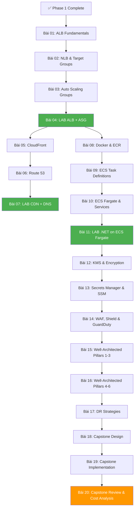

# Phase 2 — Architect Thinking: Lesson Map

> **20 bài · 6 tuần · ~50 giờ**
> Từ "biết dùng service" → "thiết kế hệ thống"

> [!NOTE]
> Phase 2 sẽ được render chi tiết khi bạn hoàn thành Phase 1.
> Outline dưới đây cho bạn thấy toàn cảnh những gì sẽ học.

---

## Dependency Graph (Preview)

---

## Module 1: ELB & Auto Scaling (4 bài)

| Bài | Tên | Thời gian | Loại |
|-----|-----|-----------|------|
| 01 | ALB Fundamentals — Layer 7 Load Balancing | ~90 min | Theory |
| 02 | NLB, Target Groups & Health Checks | ~90 min | Theory |
| 03 | Auto Scaling Groups — Launch Templates & Policies | ~90 min | Theory |
| 04 | [LAB] ALB + ASG cho .NET App — Auto Scaling thực tế | ~150 min | Lab |

**Sau module này**: Deploy .NET app đằng sau ALB, tự scale khi load tăng.

---

## Module 2: CloudFront & Route 53 (3 bài)

| Bài | Tên | Thời gian | Loại |
|-----|-----|-----------|------|
| 05 | CloudFront — CDN, Origins & Cache Behaviors | ~90 min | Theory |
| 06 | Route 53 — DNS, Routing Policies & Health Checks | ~90 min | Theory |
| 07 | [LAB] CloudFront + Route 53 — Full Stack Delivery | ~120 min | Lab |

**Sau module này**: Có custom domain, SSL, CDN cho frontend + API.

---

## Module 3: ECS/EKS — Container Orchestration (4 bài)

| Bài | Tên | Thời gian | Loại |
|-----|-----|-----------|------|
| 08 | Docker Fundamentals & ECR — Container Registry | ~90 min | Theory |
| 09 | ECS Core — Task Definitions, Clusters & Services | ~90 min | Theory |
| 10 | ECS Fargate — Serverless Containers & Service Discovery | ~90 min | Theory |
| 11 | [LAB] Dockerize & Deploy .NET API on ECS Fargate | ~180 min | Lab |

**Sau module này**: Containerize .NET app, deploy lên Fargate, production-ready.

---

## Module 4: Security Deep Dive (3 bài)

| Bài | Tên | Thời gian | Loại |
|-----|-----|-----------|------|
| 12 | KMS — Key Management & Encryption Strategy | ~90 min | Theory |
| 13 | Secrets Manager & SSM Parameter Store — .NET Integration | ~90 min | Theory + Practice |
| 14 | WAF, Shield & GuardDuty — Application Protection | ~90 min | Theory |

**Sau module này**: Manage secrets, encrypt data, protect APIs — production security posture.

---

## Module 5: Well-Architected Framework (3 bài)

| Bài | Tên | Thời gian | Loại |
|-----|-----|-----------|------|
| 15 | Pillars 1-3: Operational Excellence, Security, Reliability | ~90 min | Theory |
| 16 | Pillars 4-6: Performance, Cost Optimization, Sustainability | ~90 min | Theory |
| 17 | Disaster Recovery — RTO/RPO & DR Strategies | ~90 min | Theory |

**Sau module này**: Evaluate architecture decisions qua lens 6 pillars. Design for failure.

---

## Module 6: Capstone Project (3 bài)

| Bài | Tên | Thời gian | Loại |
|-----|-----|-----------|------|
| 18 | Capstone Design — E-Commerce API Architecture | ~120 min | Design |
| 19 | Capstone Implementation — Deploy Full Stack | ~180 min | Lab |
| 20 | Capstone Review — Cost Analysis & Improvement | ~90 min | Review |

**Sau module này**: Có production-grade project hoàn chỉnh trong portfolio.

**Capstone Requirements**:
- .NET 8 API (ECS Fargate hoặc Lambda)
- DynamoDB + RDS (hybrid database)
- ALB + Auto Scaling
- CloudFront + S3 (static assets)
- SQS for async processing
- Secrets Manager for credentials
- CloudWatch monitoring + alarms
- Estimated monthly cost analysis
- Architecture diagram

---

## Summary — Phase 2

| Module | Số bài | Theory | Lab | Tổng giờ |
|--------|--------|--------|-----|----------|
| ELB & Auto Scaling | 4 | 3 | 1 | ~7h |
| CloudFront & Route 53 | 3 | 2 | 1 | ~5h |
| ECS/EKS Containers | 4 | 3 | 1 | ~8h |
| Security Deep Dive | 3 | 3 | 0 | ~5h |
| Well-Architected | 3 | 3 | 0 | ~5h |
| Capstone | 3 | 0 | 3 | ~7h |
| **Tổng** | **20** | **14** | **6** | **~37h** |

**Pace**: 3-4 bài/tuần · ~6-7 giờ/tuần · 5-6 tuần

